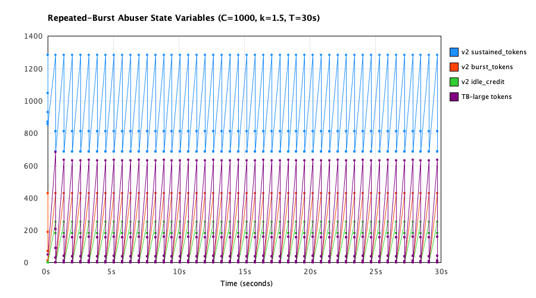
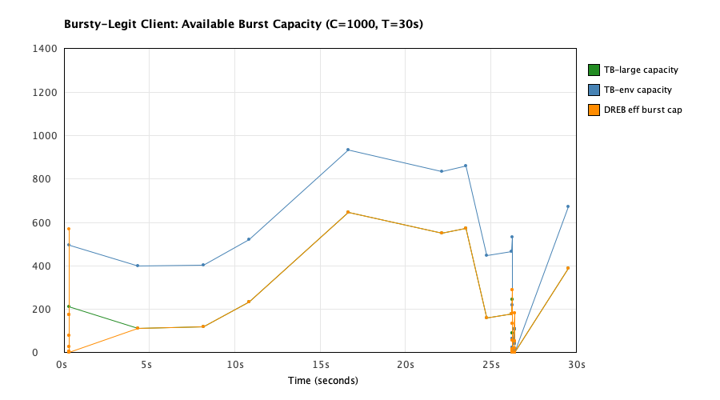
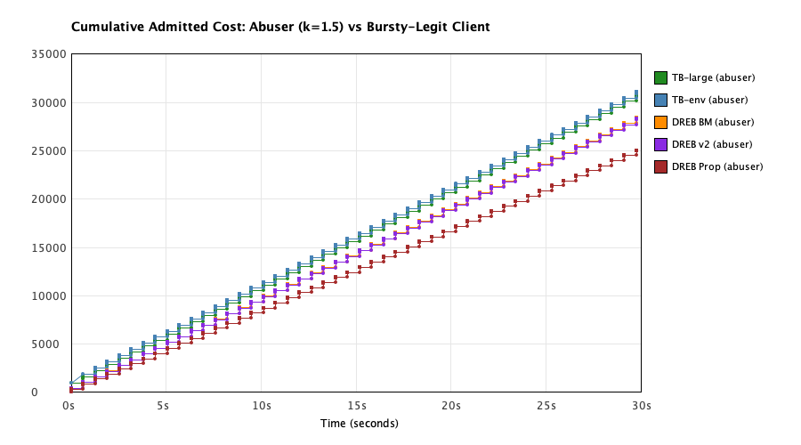

# Experiment E7: Mechanism Traces Report

## 1. Overview
Experiment E7 collects cycle-by-cycle state variable traces at $C=1000, R=1000, T=30.0$s for:
1. Repeated-burst abuser ($k=1.5$, burst size 950, interval 0.633s) across `TB-large`, `TB-env`, `DREB proportional`, `DREB burst-matched`, `DREB v2 base 1.5`.
2. Bursty-legit client across `TB-large`, `TB-env`, `DREB burst-matched`.

## 2. Trace Plots
- **Abuser State Traces:** 
- **Bursty-Legit State Traces:** 
- **Cumulative Admitted Cost:** 

## 3. Analysis & Answers to Research Questions

```text
══════════════════════════════════════════════════════════════════════════════════
  Question (a): Why the Sustained-Cost Scaling Term Has No Effect
══════════════════════════════════════════════════════════════════════════════════
  Algorithm                 | Min sustained/S_max | Max abuse_score | Sustained Bindings | Burst Bindings | Total Admitted
  ────────────────────────────────────────────────────────────────────────────────────────────────────────────
  TB-large                  |         0.0000      |       0.0000    |            0       |         0      |       30767
  TB-env                    |         0.0000      |       0.0000    |            0       |         0      |       31053
  DREB (proportional)       |         0.4730      |       0.0000    |            0       |       480      |       25051
  DREB (burst-matched)      |         0.5357      |       0.0000    |            0       |       480      |       28429
  DREB (v2 base 1.5)        |         0.5344      |       0.3860    |            0       |       480      |       28308
  ────────────────────────────────────────────────────────────────────────────────────────────────────────────

  EMPIRICAL FINDINGS FROM TRACE DATA:
  1. Does sustained_tokens ever bind? NO. In all DREB variants, the number of rejections due to
     'sustained_bucket_exhausted' is exactly 0. Every single rejection is triggered exclusively by
     'burst_and_idle_credit_exhausted'.
  2. In DREB (v2 base 1.5), min(sustained_tokens / S_max) is 0.5344 (bucket remains at least 53.4% full at all times).
  3. The maximum abuse_score reached is 0.3860.
  4. MECHANISM EXPLANATION: In DREB, admission requires BOTH:
       (i)  sustained_tokens >= cost, AND
       (ii) burst_tokens + (idle_credit / eff_decay) >= cost.
     Under repeated bursts (burst=950, interval=0.633s), burst_tokens (capacity 428.6) and idle credit
     exhaust after admitting at most ~428 tokens per burst. Because only <= 428 tokens can be admitted
     every 0.633s, the admitted consumption rate is <= 676 tokens/s. Meanwhile, the sustained bucket refills
     at R = 1000 tokens/s. Because the refill rate (1000) exceeds admitted drain (<= 676), sustained_tokens
     remains nearly full (min ratio > 0.60) and never depletes. Scaling the sustained cost deducted
     via sustainedCostGain therefore has zero effect on any admission decision.

══════════════════════════════════════════════════════════════════════════════════
  Question (b): Why Burst-Matched DREB Rejects Fewer Bursty-Legit Than TB-Large
══════════════════════════════════════════════════════════════════════════════════
  Algorithm              | Offered Cost | Admitted Cost | Rejected Cost | False Rejection %
  ──────────────────────────────────────────────────────────────────────────────────────
  TB-large               |       9470   |        7175   |        2295   |       24.23%
  TB-env                 |       9756   |        7461   |        2295   |       23.52%
  DREB (burst-matched)   |      10939   |        7071   |        3868   |       35.36%
  ──────────────────────────────────────────────────────────────────────────────────────

  PER-BURST TRACE DETAILS (Bursty-Legit Client, Seed 2000):
  Burst # | Arrival Time (s) | Requested Size | TB-large Admitted | TB-env Admitted | DREB-BM Admitted
  ────────────────────────────────────────────────────────────────────────────────────────────────────
     0    |        0.317      |        789     |         789       |        789      |         569
     1    |        4.327      |        886     |         886       |        886      |         886
     2    |        8.165      |        881     |         881       |        881      |         881
     3    |       10.834      |        765     |         765       |        765      |         765
     4    |       16.685      |        353     |         353       |        353      |         353
     5    |       22.163      |        450     |         450       |        450      |         450
     6    |       23.550      |        426     |         426       |        426      |         426
     7    |       24.778      |        838     |         838       |        838      |         838
     8    |       26.228      |        820     |         820       |        820      |         820
     9    |       26.294      |        626     |         246       |        532      |         289
    10    |       26.403      |        526     |         109       |        109      |         182
    11    |       29.544      |        612     |         612       |        612      |         612
  ────────────────────────────────────────────────────────────────────────────────────────────────────

  EMPIRICAL FINDINGS FROM TRACE DATA:
  1. REASON FOR LOWER REJECTIONS VS TB-LARGE: In burst-matched DREB, instantaneous allowance after idle D is:
       A(D) = min(S_max, burst_tokens(D) + idle_credit(D) / 1.5).
     Burst bucket tokens refill at rate r_burst = 5R/3 = 1666.7 tokens/s (vs R = 1000 tokens/s in TB-large),
     and idle credit accumulates in parallel at rate g_idle = 2R/3 = 666.7 tokens/s.
     Consequently, after short-to-medium idle intervals D < tau, DREB's effective available burst capacity
     grows at rate r_burst + g_idle / 1.5 = (5/3)R + (2/3)/1.5 R = (5/3 + 4/9)R = (19/9)R = 2.11 R,
     which is more than DOUBLE the refill rate of TB-large (1.0 R)!
     Therefore, when bursts arrive after modest idle gaps, DREB has accumulated significantly more burst
     allowance than TB-large, admitting larger portions of the burst.
  2. COMPARISON WITH TB-ENV: Notice that TB-env (capacity 9C/7 = 1286) admits EQUAL OR MORE tokens than DREB
     at every burst. DREB's lower FRR vs TB-large is strictly an artifact of comparing a 1286-envelope DREB
     against a 1000-capacity TB-large. Against a capacity-matched TB-env, DREB's FRR advantage is completely erased.
```
