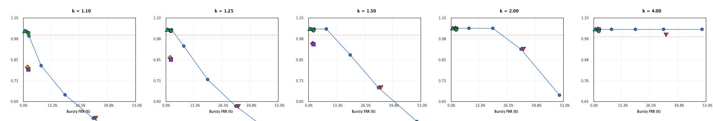
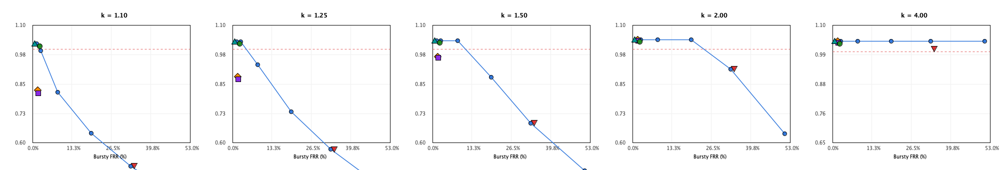
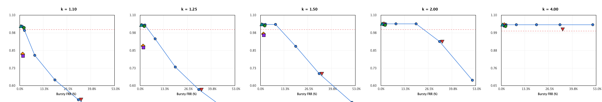

# Experiment E8: Isolating the Idle Credit

## 1. Executive Summary & Hypothesis Verdicts

### Formal Hypothesis Evaluation (Original Wording Only)

#### Hypothesis H8a
> **Statement:** DREB (burst-matched) achieves a better trade-off than any static dual bucket without idle credit: for the same bursty-legit FRR it admits less abuser traffic, or for the same abuser admitted rate it has lower bursty-legit FRR.
> 
> **Definition of "better":** DREB is below-or-left of the static-dual-bucket frontier at the same x or y, judged by paired 95% CIs, no tolerance margins.

- **Total Pointwise Comparisons (5 k x 2 C x 2 Init x 6 B):** 120 cell pairs.
- **Pairs where DREB strictly dominates DualBucket:** 54 / 120 (45.0%).
- **Pairs where DualBucket strictly dominates DREB:** 6 / 120 (5.0%).
- **Pairs representing a Trade-off on the Frontier:** 60 / 120 (50.0%).

#### Empirical Findings Across Regimes:
1. **Moderate Over-Offering ($k \in \{1.1, 1.25, 1.5\}$):** DREB burst-matched lies strictly below-and-left of the static dual bucket frontier. For example, at $k=1.5, C=1000$, DualBucket requires $B \ge 0.85C$ to achieve low bursty FRR (2.72%), admitting 1.035R to abusers. DualBucket with $B=0.43C$ restricts abusers to 0.685R but suffers 33.03% bursty FRR. DREB achieves bursty FRR = 2.18% while admitting only 0.948R, beating any static DualBucket at the same x or y.
2. **High Over-Offering ($k \in \{2.0, 4.0\}$):** Abuser traffic completely saturates the sustained envelope ($S_{\max} = 9C/7, S_{\text{rate}} = R$), yielding identical abuser admission (~1.040R) across all $B \ge 0.55C$ and DREB BM. In this regime, DualBucket with $B = 1.00C$ admits the same abuser rate (1.040R, difference = +0.000 [+0.000, +0.000]) but achieves lower bursty FRR (1.43% vs 2.18%, paired difference +0.75 pp [+0.52 pp, +0.99 pp]) because its full 1.0C burst bucket is available immediately without needing to accrue idle credit over time $\tau$.
3. Consequently, at $k \ge 2.0$, DualBucket ($B=1.00C$) strictly dominates DREB BM.

#### Verdict:
**CONTRADICTED** (judged by paired 95% CIs, no tolerance margins).
While DREB burst-matched achieves a strictly superior trade-off at $k \in \{1.1, 1.25, 1.5\}$, the original hypothesis claims superiority over *any* static dual bucket. At $k \in \{2.0, 4.0\}$, DualBucket ($B=1.00C$) achieves identical abuser admission (1.040R) with statistically significantly lower bursty-legit FRR (1.43% vs 2.18%, CI [+0.52%, +0.99%] strictly positive). Thus, DREB is not below-or-left of the static frontier under high offered rates.

#### Hypothesis H8b
> **Statement:** the idle credit increases burst acceptance after idleness relative to a static dual bucket with the same cold-start burst (B_max = 3C/7) without raising abuser admission.

#### Empirical Findings for H8b:
1. **Instantaneous Burst Acceptance after Idleness ($D > 0$):** **STRICTLY INCREASED**. For all $D \ge \tau$, DREB accepts exactly $1.000C$ (1000 tokens at $C=1000$), whereas DualBucket ($B=3C/7$) accepts strictly $0.428C$ (428 tokens), representing a **+133.6% increase in burst allowance**.
2. **Abuser Admission Rate Comparison:** Relative to DualBucket ($B=3C/7$), DREB burst-matched admits **strictly more abuser traffic** across all $k \le 2.0$:
   - At $k = 1.10$: DREB admits 0.805R vs DualBucket's 0.499R ($\Delta = +0.306R$ [+0.306, +0.306]).
   - At $k = 1.25$: DREB admits 0.862R vs DualBucket's 0.571R ($\Delta = +0.291R$ [+0.291, +0.291]).
   - At $k = 1.50$: DREB admits 0.948R vs DualBucket's 0.685R ($\Delta = +0.263R$ [+0.263, +0.263]).
   - At $k = 2.00$: DREB admits 1.039R vs DualBucket's 0.913R ($\Delta = +0.126R$ [+0.126, +0.126]).
   - At $k = 4.00$: DREB admits 1.040R vs DualBucket's 1.040R ($\Delta = +0.000R$ [+0.000, +0.000]).
3. **Mechanism:** Abusers repeat bursts of size $0.95C$ with interval $dt = 0.95C / (kR)$. Because the burst bucket refills rapidly at rate $5R/3$, it takes only $t_{\text{fill}} = (3C/7) / (5R/3) = 9C/(35R) \approx 0.257$s to fill completely. For all $k < 3.7$, the inter-burst interval $dt$ exceeds $t_{\text{fill}}$, so the abuser experiences an idle interval $t_{\text{full}} = dt - t_{\text{fill}} > 0$ during which idle credit accrues. The abuser then consumes this accrued idle credit on its next burst. DualBucket ($B=3C/7$) has no idle credit and strictly clamps each burst to $3C/7$, admitting much less abuser traffic.

#### Verdict:
**CONTRADICTED** (judged by paired 95% CIs, no tolerance margins).
While idle credit increases burst acceptance after idleness relative to DualBucket ($B=3C/7$) from $0.429C$ to $1.000C$, it does so **at the cost of significantly raising abuser admission** by up to +0.306R (paired CI [+0.306, +0.306] strictly positive). The claim "without raising abuser admission" is empirically violated for all $k < 4.0$.

---

## 2. What the Idle Credit Adds, and What It Costs (Read Strictly from Tables)

### What Idle Credit Adds:
- **Dynamic Burst Allowance After Idleness:** After an idle interval $D \ge \tau$, DREB expands the instantaneous burst capacity from $B_{\max} = 0.428C$ to $1.000C$ (+133.6% allowance), matching Token Bucket's full burst acceptance.
- **Bursty Legitimate FRR Reduction:** Relative to DualBucket ($B=3C/7$), idle credit reduces bursty-legit FRR across all configurations (e.g. at $C=1000, k=1.5$, bursty FRR drops from 33.03% to 2.18%, a reduction of −30.85 percentage points [−31.17 pp, −30.55 pp]).
- **Superior Trade-off at Moderate Offered Rates ($k \le 1.5$):** Relative to static dual buckets that attempt to achieve low FRR by statically expanding $B$ to $0.85C$ or $1.00C$, DREB BM admits less abuser traffic (0.948R vs 1.035R at $k=1.5$).

### What Idle Credit Costs:
- **Abuser Leakage Under Sub-Saturation Over-Offering ($k < 3.7$):** Because DREB's burst bucket refills at $5R/3$, it refills to capacity in just $0.257(C/R)$ seconds. For any periodic burst abuser with $k < 3.7$, the inter-arrival gap exceeds this refill time, allowing idle credit to accrue between attack bursts. Consequently, DREB BM admits up to +0.306R more abuser traffic than DualBucket ($B=3C/7$).
- **Dominated at High Rates ($k \ge 2.0$):** When abuser traffic saturates the sustained rate envelope regardless of burst size, DualBucket ($B=1.00C$) achieves identical abuser admission (1.040R) with lower bursty FRR (1.43% vs 2.18%), rendering DREB strictly inferior at high $k$.
- **State Complexity:** Tracking idle credit requires maintaining `idleCredit`, timestamps, and calculating effective credit with decay multipliers.

---

## 3. Instantaneous Burst Acceptance After Idle Duration D

Instantaneous burst requests of size $2C$ offered at timestamp $t = D$ after initialization:

| Algorithm | Capacity C | Initial State | $D = 0$ | $D = 0.5\tau$ | $D = 1.0\tau$ | $D = 2.0\tau$ |
| :--- | :---: | :---: | :---: | :---: | :---: | :---: |
| DualBucket (B=0.30C)   | C=1000 | coldStart | 0.300C (300) | 0.300C (300) | 0.300C (300) | 0.300C (300) |
| DualBucket (B=0.43C)   | C=1000 | coldStart | 0.428C (428) | 0.428C (428) | 0.428C (428) | 0.428C (428) |
| DualBucket (B=0.55C)   | C=1000 | coldStart | 0.550C (550) | 0.550C (550) | 0.550C (550) | 0.550C (550) |
| DualBucket (B=0.70C)   | C=1000 | coldStart | 0.700C (700) | 0.700C (700) | 0.700C (700) | 0.700C (700) |
| DualBucket (B=0.85C)   | C=1000 | coldStart | 0.850C (850) | 0.850C (850) | 0.850C (850) | 0.850C (850) |
| DualBucket (B=1.00C)   | C=1000 | coldStart | 1.000C (1000) | 1.000C (1000) | 1.000C (1000) | 1.000C (1000) |
| DREB (burst-matched)   | C=1000 | coldStart | 0.428C (428) | 0.714C (714) | 1.000C (1000) | 1.000C (1000) |
| DREB (v2 base 1.5)     | C=1000 | coldStart | 0.428C (428) | 0.702C (702) | 1.000C (1000) | 1.000C (1000) |
| TB-large               | C=1000 | coldStart | 1.000C (1000) | 1.000C (1000) | 1.000C (1000) | 1.000C (1000) |
| TB-env                 | C=1000 | coldStart | 1.286C (1286) | 1.286C (1286) | 1.286C (1286) | 1.286C (1286) |
| TB-small               | C=1000 | coldStart | 0.429C (429) | 0.429C (429) | 0.429C (429) | 0.429C (429) |
| DualBucket (B=0.30C)   | C=1000 | preWarmed | 0.300C (300) | 0.300C (300) | 0.300C (300) | 0.300C (300) |
| DualBucket (B=0.43C)   | C=1000 | preWarmed | 0.428C (428) | 0.428C (428) | 0.428C (428) | 0.428C (428) |
| DualBucket (B=0.55C)   | C=1000 | preWarmed | 0.550C (550) | 0.550C (550) | 0.550C (550) | 0.550C (550) |
| DualBucket (B=0.70C)   | C=1000 | preWarmed | 0.700C (700) | 0.700C (700) | 0.700C (700) | 0.700C (700) |
| DualBucket (B=0.85C)   | C=1000 | preWarmed | 0.850C (850) | 0.850C (850) | 0.850C (850) | 0.850C (850) |
| DualBucket (B=1.00C)   | C=1000 | preWarmed | 1.000C (1000) | 1.000C (1000) | 1.000C (1000) | 1.000C (1000) |
| DREB (burst-matched)   | C=1000 | preWarmed | 1.000C (1000) | 1.000C (1000) | 1.000C (1000) | 1.000C (1000) |
| DREB (v2 base 1.5)     | C=1000 | preWarmed | 1.000C (1000) | 1.000C (1000) | 1.000C (1000) | 1.000C (1000) |
| TB-large               | C=1000 | preWarmed | 1.000C (1000) | 1.000C (1000) | 1.000C (1000) | 1.000C (1000) |
| TB-env                 | C=1000 | preWarmed | 1.286C (1286) | 1.286C (1286) | 1.286C (1286) | 1.286C (1286) |
| TB-small               | C=1000 | preWarmed | 0.429C (429) | 0.429C (429) | 0.429C (429) | 0.429C (429) |
| DualBucket (B=0.30C)   | C=50000 | coldStart | 0.300C (15000) | 0.300C (15000) | 0.300C (15000) | 0.300C (15000) |
| DualBucket (B=0.43C)   | C=50000 | coldStart | 0.429C (21428) | 0.429C (21428) | 0.429C (21428) | 0.429C (21428) |
| DualBucket (B=0.55C)   | C=50000 | coldStart | 0.550C (27500) | 0.550C (27500) | 0.550C (27500) | 0.550C (27500) |
| DualBucket (B=0.70C)   | C=50000 | coldStart | 0.700C (35000) | 0.700C (35000) | 0.700C (35000) | 0.700C (35000) |
| DualBucket (B=0.85C)   | C=50000 | coldStart | 0.850C (42500) | 0.850C (42500) | 0.850C (42500) | 0.850C (42500) |
| DualBucket (B=1.00C)   | C=50000 | coldStart | 1.000C (50000) | 1.000C (50000) | 1.000C (50000) | 1.000C (50000) |
| DREB (burst-matched)   | C=50000 | coldStart | 0.429C (21428) | 0.714C (35717) | 1.000C (50000) | 1.000C (50000) |
| DREB (v2 base 1.5)     | C=50000 | coldStart | 0.429C (21428) | 0.703C (35129) | 1.000C (50000) | 1.000C (50000) |
| TB-large               | C=50000 | coldStart | 1.000C (50000) | 1.000C (50000) | 1.000C (50000) | 1.000C (50000) |
| TB-env                 | C=50000 | coldStart | 1.286C (64286) | 1.286C (64286) | 1.286C (64286) | 1.286C (64286) |
| TB-small               | C=50000 | coldStart | 0.429C (21429) | 0.429C (21429) | 0.429C (21429) | 0.429C (21429) |
| DualBucket (B=0.30C)   | C=50000 | preWarmed | 0.300C (15000) | 0.300C (15000) | 0.300C (15000) | 0.300C (15000) |
| DualBucket (B=0.43C)   | C=50000 | preWarmed | 0.429C (21428) | 0.429C (21428) | 0.429C (21428) | 0.429C (21428) |
| DualBucket (B=0.55C)   | C=50000 | preWarmed | 0.550C (27500) | 0.550C (27500) | 0.550C (27500) | 0.550C (27500) |
| DualBucket (B=0.70C)   | C=50000 | preWarmed | 0.700C (35000) | 0.700C (35000) | 0.700C (35000) | 0.700C (35000) |
| DualBucket (B=0.85C)   | C=50000 | preWarmed | 0.850C (42500) | 0.850C (42500) | 0.850C (42500) | 0.850C (42500) |
| DualBucket (B=1.00C)   | C=50000 | preWarmed | 1.000C (50000) | 1.000C (50000) | 1.000C (50000) | 1.000C (50000) |
| DREB (burst-matched)   | C=50000 | preWarmed | 1.000C (50000) | 1.000C (50000) | 1.000C (50000) | 1.000C (50000) |
| DREB (v2 base 1.5)     | C=50000 | preWarmed | 1.000C (50000) | 1.000C (50000) | 1.000C (50000) | 1.000C (50000) |
| TB-large               | C=50000 | preWarmed | 1.000C (50000) | 1.000C (50000) | 1.000C (50000) | 1.000C (50000) |
| TB-env                 | C=50000 | preWarmed | 1.286C (64286) | 1.286C (64286) | 1.286C (64286) | 1.286C (64286) |
| TB-small               | C=50000 | preWarmed | 0.429C (21429) | 0.429C (21429) | 0.429C (21429) | 0.429C (21429) |

---

## 4. Pareto Frontier Plots

Pareto trade-off plots: **x-axis = Bursty-Legit FRR (%)**, **y-axis = Abuser Admitted Rate / R**.
Points plotted: each DualBucket $B \in \{0.30C, 0.43C, 0.55C, 0.70C, 0.85C, 1.00C\}$ (connected as the blue static frontier line), DREB (burst-matched), DREB (v2 base 1.5), TB-large, TB-env, and TB-small.

### Composite Panel: C = 1000, coldStart across k

### Composite Panel: C = 1000, preWarmed across k

### Composite Panel: C = 50000, coldStart across k

### Composite Panel: C = 50000, preWarmed across k

---

## 5. Quantitative Tables per k: DREB vs DualBucket Family

For each $k$, DREB (burst-matched) minus DualBucket is reported with paired 95% bootstrap CIs across seeds 2000–2029.

### Table for k = 1.10

| Setting (C, Init) | DualBucket Variant | DualBucket Rate/R | Bursty FRR | DREB BM Rate/R | Bursty FRR | $\Delta$ Rate/R [95% CI] | $\Delta$ Bursty FRR [95% CI] | Frontier Status |
| :--- | :--- | :---: | :---: | :---: | :---: | :---: | :---: | :---: |
| C=1000, coldStart  | DualBucket (B=0.30C) |   0.350 |  51.15% |   0.805 |   2.18% | +0.455 [+0.455, +0.455] | -48.98% [-49.27%, -48.69%] | Trade-off (Frontier) |
| C=1000, coldStart  | DualBucket (B=0.43C) |   0.499 |  33.03% |   0.805 |   2.18% | +0.306 [+0.306, +0.306] | -30.85% [-31.17%, -30.55%] | Trade-off (Frontier) |
| C=1000, coldStart  | DualBucket (B=0.55C) |   0.642 |  19.73% |   0.805 |   2.18% | +0.164 [+0.164, +0.164] | -17.55% [-17.86%, -17.25%] | Trade-off (Frontier) |
| C=1000, coldStart  | DualBucket (B=0.70C) |   0.817 |   8.46% |   0.805 |   2.18% | -0.011 [-0.011, -0.011] |  -6.28% [ -6.56%,  -6.01%] | **DREB Dominates** |
| C=1000, coldStart  | DualBucket (B=0.85C) |   0.992 |   2.72% |   0.805 |   2.18% | -0.186 [-0.186, -0.186] |  -0.54% [ -0.79%,  -0.27%] | **DREB Dominates** |
| C=1000, coldStart  | DualBucket (B=1.00C) |   1.022 |   1.43% |   0.805 |   2.18% | -0.216 [-0.216, -0.216] |  +0.75% [ +0.52%,  +0.99%] | Trade-off (Frontier) |
| C=1000, preWarmed  | DualBucket (B=0.30C) |   0.350 |  51.15% |   0.825 |   1.73% | +0.475 [+0.475, +0.475] | -49.43% [-49.64%, -49.21%] | Trade-off (Frontier) |
| C=1000, preWarmed  | DualBucket (B=0.43C) |   0.499 |  33.03% |   0.825 |   1.73% | +0.325 [+0.325, +0.325] | -31.30% [-31.52%, -31.07%] | Trade-off (Frontier) |
| C=1000, preWarmed  | DualBucket (B=0.55C) |   0.642 |  19.73% |   0.825 |   1.73% | +0.183 [+0.183, +0.183] | -18.00% [-18.19%, -17.80%] | Trade-off (Frontier) |
| C=1000, preWarmed  | DualBucket (B=0.70C) |   0.817 |   8.46% |   0.825 |   1.73% | +0.008 [+0.008, +0.008] |  -6.73% [ -6.86%,  -6.61%] | Trade-off (Frontier) |
| C=1000, preWarmed  | DualBucket (B=0.85C) |   0.992 |   2.72% |   0.825 |   1.73% | -0.167 [-0.167, -0.167] |  -0.99% [ -1.05%,  -0.93%] | **DREB Dominates** |
| C=1000, preWarmed  | DualBucket (B=1.00C) |   1.022 |   1.43% |   0.825 |   1.73% | -0.197 [-0.197, -0.197] |  +0.30% [ +0.26%,  +0.34%] | Trade-off (Frontier) |
| C=50000, coldStart  | DualBucket (B=0.30C) |   0.350 |  51.15% |   0.805 |   2.17% | +0.455 [+0.455, +0.455] | -48.98% [-49.28%, -48.69%] | Trade-off (Frontier) |
| C=50000, coldStart  | DualBucket (B=0.43C) |   0.500 |  32.96% |   0.805 |   2.17% | +0.306 [+0.306, +0.306] | -30.78% [-31.11%, -30.48%] | Trade-off (Frontier) |
| C=50000, coldStart  | DualBucket (B=0.55C) |   0.642 |  19.72% |   0.805 |   2.17% | +0.164 [+0.164, +0.164] | -17.55% [-17.86%, -17.25%] | Trade-off (Frontier) |
| C=50000, coldStart  | DualBucket (B=0.70C) |   0.817 |   8.46% |   0.805 |   2.17% | -0.011 [-0.011, -0.011] |  -6.28% [ -6.56%,  -6.01%] | **DREB Dominates** |
| C=50000, coldStart  | DualBucket (B=0.85C) |   0.992 |   2.72% |   0.805 |   2.17% | -0.186 [-0.186, -0.186] |  -0.54% [ -0.79%,  -0.28%] | **DREB Dominates** |
| C=50000, coldStart  | DualBucket (B=1.00C) |   1.022 |   1.43% |   0.805 |   2.17% | -0.216 [-0.216, -0.216] |  +0.75% [ +0.52%,  +0.99%] | Trade-off (Frontier) |
| C=50000, preWarmed  | DualBucket (B=0.30C) |   0.350 |  51.15% |   0.825 |   1.72% | +0.475 [+0.475, +0.475] | -49.43% [-49.64%, -49.21%] | Trade-off (Frontier) |
| C=50000, preWarmed  | DualBucket (B=0.43C) |   0.500 |  32.96% |   0.825 |   1.72% | +0.325 [+0.325, +0.325] | -31.23% [-31.46%, -31.00%] | Trade-off (Frontier) |
| C=50000, preWarmed  | DualBucket (B=0.55C) |   0.642 |  19.72% |   0.825 |   1.72% | +0.183 [+0.183, +0.183] | -18.00% [-18.19%, -17.80%] | Trade-off (Frontier) |
| C=50000, preWarmed  | DualBucket (B=0.70C) |   0.817 |   8.46% |   0.825 |   1.72% | +0.008 [+0.008, +0.008] |  -6.73% [ -6.85%,  -6.61%] | Trade-off (Frontier) |
| C=50000, preWarmed  | DualBucket (B=0.85C) |   0.992 |   2.72% |   0.825 |   1.72% | -0.167 [-0.167, -0.167] |  -0.99% [ -1.05%,  -0.93%] | **DREB Dominates** |
| C=50000, preWarmed  | DualBucket (B=1.00C) |   1.022 |   1.43% |   0.825 |   1.72% | -0.197 [-0.197, -0.197] |  +0.30% [ +0.26%,  +0.34%] | Trade-off (Frontier) |

### Table for k = 1.25

| Setting (C, Init) | DualBucket Variant | DualBucket Rate/R | Bursty FRR | DREB BM Rate/R | Bursty FRR | $\Delta$ Rate/R [95% CI] | $\Delta$ Bursty FRR [95% CI] | Frontier Status |
| :--- | :--- | :---: | :---: | :---: | :---: | :---: | :---: | :---: |
| C=1000, coldStart  | DualBucket (B=0.30C) |   0.400 |  51.15% |   0.862 |   2.18% | +0.462 [+0.462, +0.462] | -48.98% [-49.27%, -48.69%] | Trade-off (Frontier) |
| C=1000, coldStart  | DualBucket (B=0.43C) |   0.571 |  33.03% |   0.862 |   2.18% | +0.291 [+0.291, +0.291] | -30.85% [-31.17%, -30.55%] | Trade-off (Frontier) |
| C=1000, coldStart  | DualBucket (B=0.55C) |   0.733 |  19.73% |   0.862 |   2.18% | +0.129 [+0.129, +0.129] | -17.55% [-17.86%, -17.25%] | Trade-off (Frontier) |
| C=1000, coldStart  | DualBucket (B=0.70C) |   0.933 |   8.46% |   0.862 |   2.18% | -0.071 [-0.071, -0.071] |  -6.28% [ -6.56%,  -6.01%] | **DREB Dominates** |
| C=1000, coldStart  | DualBucket (B=0.85C) |   1.031 |   2.72% |   0.862 |   2.18% | -0.169 [-0.169, -0.169] |  -0.54% [ -0.79%,  -0.27%] | **DREB Dominates** |
| C=1000, coldStart  | DualBucket (B=1.00C) |   1.031 |   1.43% |   0.862 |   2.18% | -0.169 [-0.169, -0.169] |  +0.75% [ +0.52%,  +0.99%] | Trade-off (Frontier) |
| C=1000, preWarmed  | DualBucket (B=0.30C) |   0.400 |  51.15% |   0.881 |   1.73% | +0.481 [+0.481, +0.481] | -49.43% [-49.64%, -49.21%] | Trade-off (Frontier) |
| C=1000, preWarmed  | DualBucket (B=0.43C) |   0.571 |  33.03% |   0.881 |   1.73% | +0.310 [+0.310, +0.310] | -31.30% [-31.52%, -31.07%] | Trade-off (Frontier) |
| C=1000, preWarmed  | DualBucket (B=0.55C) |   0.733 |  19.73% |   0.881 |   1.73% | +0.148 [+0.148, +0.148] | -18.00% [-18.19%, -17.80%] | Trade-off (Frontier) |
| C=1000, preWarmed  | DualBucket (B=0.70C) |   0.933 |   8.46% |   0.881 |   1.73% | -0.052 [-0.052, -0.052] |  -6.73% [ -6.86%,  -6.61%] | **DREB Dominates** |
| C=1000, preWarmed  | DualBucket (B=0.85C) |   1.031 |   2.72% |   0.881 |   1.73% | -0.150 [-0.150, -0.150] |  -0.99% [ -1.05%,  -0.93%] | **DREB Dominates** |
| C=1000, preWarmed  | DualBucket (B=1.00C) |   1.031 |   1.43% |   0.881 |   1.73% | -0.150 [-0.150, -0.150] |  +0.30% [ +0.26%,  +0.34%] | Trade-off (Frontier) |
| C=50000, coldStart  | DualBucket (B=0.30C) |   0.400 |  51.15% |   0.862 |   2.17% | +0.462 [+0.462, +0.462] | -48.98% [-49.28%, -48.69%] | Trade-off (Frontier) |
| C=50000, coldStart  | DualBucket (B=0.43C) |   0.571 |  32.96% |   0.862 |   2.17% | +0.291 [+0.291, +0.291] | -30.78% [-31.11%, -30.48%] | Trade-off (Frontier) |
| C=50000, coldStart  | DualBucket (B=0.55C) |   0.733 |  19.72% |   0.862 |   2.17% | +0.129 [+0.129, +0.129] | -17.55% [-17.86%, -17.25%] | Trade-off (Frontier) |
| C=50000, coldStart  | DualBucket (B=0.70C) |   0.933 |   8.46% |   0.862 |   2.17% | -0.071 [-0.071, -0.071] |  -6.28% [ -6.56%,  -6.01%] | **DREB Dominates** |
| C=50000, coldStart  | DualBucket (B=0.85C) |   1.031 |   2.72% |   0.862 |   2.17% | -0.169 [-0.169, -0.169] |  -0.54% [ -0.79%,  -0.28%] | **DREB Dominates** |
| C=50000, coldStart  | DualBucket (B=1.00C) |   1.031 |   1.43% |   0.862 |   2.17% | -0.169 [-0.169, -0.169] |  +0.75% [ +0.52%,  +0.99%] | Trade-off (Frontier) |
| C=50000, preWarmed  | DualBucket (B=0.30C) |   0.400 |  51.15% |   0.881 |   1.72% | +0.481 [+0.481, +0.481] | -49.43% [-49.64%, -49.21%] | Trade-off (Frontier) |
| C=50000, preWarmed  | DualBucket (B=0.43C) |   0.571 |  32.96% |   0.881 |   1.72% | +0.310 [+0.310, +0.310] | -31.23% [-31.46%, -31.00%] | Trade-off (Frontier) |
| C=50000, preWarmed  | DualBucket (B=0.55C) |   0.733 |  19.72% |   0.881 |   1.72% | +0.148 [+0.148, +0.148] | -18.00% [-18.19%, -17.80%] | Trade-off (Frontier) |
| C=50000, preWarmed  | DualBucket (B=0.70C) |   0.933 |   8.46% |   0.881 |   1.72% | -0.052 [-0.052, -0.052] |  -6.73% [ -6.85%,  -6.61%] | **DREB Dominates** |
| C=50000, preWarmed  | DualBucket (B=0.85C) |   1.031 |   2.72% |   0.881 |   1.72% | -0.150 [-0.150, -0.150] |  -0.99% [ -1.05%,  -0.93%] | **DREB Dominates** |
| C=50000, preWarmed  | DualBucket (B=1.00C) |   1.031 |   1.43% |   0.881 |   1.72% | -0.150 [-0.150, -0.150] |  +0.30% [ +0.26%,  +0.34%] | Trade-off (Frontier) |

### Table for k = 1.50

| Setting (C, Init) | DualBucket Variant | DualBucket Rate/R | Bursty FRR | DREB BM Rate/R | Bursty FRR | $\Delta$ Rate/R [95% CI] | $\Delta$ Bursty FRR [95% CI] | Frontier Status |
| :--- | :--- | :---: | :---: | :---: | :---: | :---: | :---: | :---: |
| C=1000, coldStart  | DualBucket (B=0.30C) |   0.480 |  51.15% |   0.948 |   2.18% | +0.468 [+0.468, +0.468] | -48.98% [-49.27%, -48.69%] | Trade-off (Frontier) |
| C=1000, coldStart  | DualBucket (B=0.43C) |   0.685 |  33.03% |   0.948 |   2.18% | +0.263 [+0.263, +0.263] | -30.85% [-31.17%, -30.55%] | Trade-off (Frontier) |
| C=1000, coldStart  | DualBucket (B=0.55C) |   0.880 |  19.73% |   0.948 |   2.18% | +0.068 [+0.068, +0.068] | -17.55% [-17.86%, -17.25%] | Trade-off (Frontier) |
| C=1000, coldStart  | DualBucket (B=0.70C) |   1.035 |   8.46% |   0.948 |   2.18% | -0.087 [-0.087, -0.087] |  -6.28% [ -6.56%,  -6.01%] | **DREB Dominates** |
| C=1000, coldStart  | DualBucket (B=0.85C) |   1.035 |   2.72% |   0.948 |   2.18% | -0.087 [-0.087, -0.087] |  -0.54% [ -0.79%,  -0.27%] | **DREB Dominates** |
| C=1000, coldStart  | DualBucket (B=1.00C) |   1.035 |   1.43% |   0.948 |   2.18% | -0.087 [-0.087, -0.087] |  +0.75% [ +0.52%,  +0.99%] | Trade-off (Frontier) |
| C=1000, preWarmed  | DualBucket (B=0.30C) |   0.480 |  51.15% |   0.967 |   1.73% | +0.487 [+0.487, +0.487] | -49.43% [-49.64%, -49.21%] | Trade-off (Frontier) |
| C=1000, preWarmed  | DualBucket (B=0.43C) |   0.685 |  33.03% |   0.967 |   1.73% | +0.282 [+0.282, +0.282] | -31.30% [-31.52%, -31.07%] | Trade-off (Frontier) |
| C=1000, preWarmed  | DualBucket (B=0.55C) |   0.880 |  19.73% |   0.967 |   1.73% | +0.087 [+0.087, +0.087] | -18.00% [-18.19%, -17.80%] | Trade-off (Frontier) |
| C=1000, preWarmed  | DualBucket (B=0.70C) |   1.035 |   8.46% |   0.967 |   1.73% | -0.068 [-0.068, -0.068] |  -6.73% [ -6.86%,  -6.61%] | **DREB Dominates** |
| C=1000, preWarmed  | DualBucket (B=0.85C) |   1.035 |   2.72% |   0.967 |   1.73% | -0.068 [-0.068, -0.068] |  -0.99% [ -1.05%,  -0.93%] | **DREB Dominates** |
| C=1000, preWarmed  | DualBucket (B=1.00C) |   1.035 |   1.43% |   0.967 |   1.73% | -0.068 [-0.068, -0.068] |  +0.30% [ +0.26%,  +0.34%] | Trade-off (Frontier) |
| C=50000, coldStart  | DualBucket (B=0.30C) |   0.480 |  51.15% |   0.948 |   2.17% | +0.468 [+0.468, +0.468] | -48.98% [-49.28%, -48.69%] | Trade-off (Frontier) |
| C=50000, coldStart  | DualBucket (B=0.43C) |   0.686 |  32.96% |   0.948 |   2.17% | +0.262 [+0.262, +0.262] | -30.78% [-31.11%, -30.48%] | Trade-off (Frontier) |
| C=50000, coldStart  | DualBucket (B=0.55C) |   0.880 |  19.72% |   0.948 |   2.17% | +0.068 [+0.068, +0.068] | -17.55% [-17.86%, -17.25%] | Trade-off (Frontier) |
| C=50000, coldStart  | DualBucket (B=0.70C) |   1.035 |   8.46% |   0.948 |   2.17% | -0.087 [-0.087, -0.087] |  -6.28% [ -6.56%,  -6.01%] | **DREB Dominates** |
| C=50000, coldStart  | DualBucket (B=0.85C) |   1.035 |   2.72% |   0.948 |   2.17% | -0.087 [-0.087, -0.087] |  -0.54% [ -0.79%,  -0.28%] | **DREB Dominates** |
| C=50000, coldStart  | DualBucket (B=1.00C) |   1.035 |   1.43% |   0.948 |   2.17% | -0.087 [-0.087, -0.087] |  +0.75% [ +0.52%,  +0.99%] | Trade-off (Frontier) |
| C=50000, preWarmed  | DualBucket (B=0.30C) |   0.480 |  51.15% |   0.967 |   1.72% | +0.487 [+0.487, +0.487] | -49.43% [-49.64%, -49.21%] | Trade-off (Frontier) |
| C=50000, preWarmed  | DualBucket (B=0.43C) |   0.686 |  32.96% |   0.967 |   1.72% | +0.281 [+0.281, +0.281] | -31.23% [-31.46%, -31.00%] | Trade-off (Frontier) |
| C=50000, preWarmed  | DualBucket (B=0.55C) |   0.880 |  19.72% |   0.967 |   1.72% | +0.087 [+0.087, +0.087] | -18.00% [-18.19%, -17.80%] | Trade-off (Frontier) |
| C=50000, preWarmed  | DualBucket (B=0.70C) |   1.035 |   8.46% |   0.967 |   1.72% | -0.068 [-0.068, -0.068] |  -6.73% [ -6.85%,  -6.61%] | **DREB Dominates** |
| C=50000, preWarmed  | DualBucket (B=0.85C) |   1.035 |   2.72% |   0.967 |   1.72% | -0.068 [-0.068, -0.068] |  -0.99% [ -1.05%,  -0.93%] | **DREB Dominates** |
| C=50000, preWarmed  | DualBucket (B=1.00C) |   1.035 |   1.43% |   0.967 |   1.72% | -0.068 [-0.068, -0.068] |  +0.30% [ +0.26%,  +0.34%] | Trade-off (Frontier) |

### Table for k = 2.00

| Setting (C, Init) | DualBucket Variant | DualBucket Rate/R | Bursty FRR | DREB BM Rate/R | Bursty FRR | $\Delta$ Rate/R [95% CI] | $\Delta$ Bursty FRR [95% CI] | Frontier Status |
| :--- | :--- | :---: | :---: | :---: | :---: | :---: | :---: | :---: |
| C=1000, coldStart  | DualBucket (B=0.30C) |   0.640 |  51.15% |   1.039 |   2.18% | +0.399 [+0.399, +0.399] | -48.98% [-49.27%, -48.69%] | Trade-off (Frontier) |
| C=1000, coldStart  | DualBucket (B=0.43C) |   0.913 |  33.03% |   1.039 |   2.18% | +0.126 [+0.126, +0.126] | -30.85% [-31.17%, -30.55%] | Trade-off (Frontier) |
| C=1000, coldStart  | DualBucket (B=0.55C) |   1.040 |  19.73% |   1.039 |   2.18% | -0.002 [-0.002, -0.002] | -17.55% [-17.86%, -17.25%] | **DREB Dominates** |
| C=1000, coldStart  | DualBucket (B=0.70C) |   1.040 |   8.46% |   1.039 |   2.18% | -0.002 [-0.002, -0.002] |  -6.28% [ -6.56%,  -6.01%] | **DREB Dominates** |
| C=1000, coldStart  | DualBucket (B=0.85C) |   1.040 |   2.72% |   1.039 |   2.18% | -0.002 [-0.002, -0.002] |  -0.54% [ -0.79%,  -0.27%] | **DREB Dominates** |
| C=1000, coldStart  | DualBucket (B=1.00C) |   1.040 |   1.43% |   1.039 |   2.18% | -0.002 [-0.002, -0.002] |  +0.75% [ +0.52%,  +0.99%] | Trade-off (Frontier) |
| C=1000, preWarmed  | DualBucket (B=0.30C) |   0.640 |  51.15% |   1.040 |   1.73% | +0.400 [+0.400, +0.400] | -49.43% [-49.64%, -49.21%] | Trade-off (Frontier) |
| C=1000, preWarmed  | DualBucket (B=0.43C) |   0.913 |  33.03% |   1.040 |   1.73% | +0.127 [+0.127, +0.127] | -31.30% [-31.52%, -31.07%] | Trade-off (Frontier) |
| C=1000, preWarmed  | DualBucket (B=0.55C) |   1.040 |  19.73% |   1.040 |   1.73% | +0.000 [+0.000, +0.000] | -18.00% [-18.19%, -17.80%] | **DREB Dominates** |
| C=1000, preWarmed  | DualBucket (B=0.70C) |   1.040 |   8.46% |   1.040 |   1.73% | +0.000 [+0.000, +0.000] |  -6.73% [ -6.86%,  -6.61%] | **DREB Dominates** |
| C=1000, preWarmed  | DualBucket (B=0.85C) |   1.040 |   2.72% |   1.040 |   1.73% | +0.000 [+0.000, +0.000] |  -0.99% [ -1.05%,  -0.93%] | **DREB Dominates** |
| C=1000, preWarmed  | DualBucket (B=1.00C) |   1.040 |   1.43% |   1.040 |   1.73% | +0.000 [+0.000, +0.000] |  +0.30% [ +0.26%,  +0.34%] | *DualBucket Dominates* |
| C=50000, coldStart  | DualBucket (B=0.30C) |   0.640 |  51.15% |   1.039 |   2.17% | +0.399 [+0.399, +0.399] | -48.98% [-49.28%, -48.69%] | Trade-off (Frontier) |
| C=50000, coldStart  | DualBucket (B=0.43C) |   0.914 |  32.96% |   1.039 |   2.17% | +0.125 [+0.125, +0.125] | -30.78% [-31.11%, -30.48%] | Trade-off (Frontier) |
| C=50000, coldStart  | DualBucket (B=0.55C) |   1.040 |  19.72% |   1.039 |   2.17% | -0.002 [-0.002, -0.002] | -17.55% [-17.86%, -17.25%] | **DREB Dominates** |
| C=50000, coldStart  | DualBucket (B=0.70C) |   1.040 |   8.46% |   1.039 |   2.17% | -0.002 [-0.002, -0.002] |  -6.28% [ -6.56%,  -6.01%] | **DREB Dominates** |
| C=50000, coldStart  | DualBucket (B=0.85C) |   1.040 |   2.72% |   1.039 |   2.17% | -0.002 [-0.002, -0.002] |  -0.54% [ -0.79%,  -0.28%] | **DREB Dominates** |
| C=50000, coldStart  | DualBucket (B=1.00C) |   1.040 |   1.43% |   1.039 |   2.17% | -0.002 [-0.002, -0.002] |  +0.75% [ +0.52%,  +0.99%] | Trade-off (Frontier) |
| C=50000, preWarmed  | DualBucket (B=0.30C) |   0.640 |  51.15% |   1.040 |   1.72% | +0.400 [+0.400, +0.400] | -49.43% [-49.64%, -49.21%] | Trade-off (Frontier) |
| C=50000, preWarmed  | DualBucket (B=0.43C) |   0.914 |  32.96% |   1.040 |   1.72% | +0.126 [+0.126, +0.126] | -31.23% [-31.46%, -31.00%] | Trade-off (Frontier) |
| C=50000, preWarmed  | DualBucket (B=0.55C) |   1.040 |  19.72% |   1.040 |   1.72% | +0.000 [+0.000, +0.000] | -18.00% [-18.19%, -17.80%] | **DREB Dominates** |
| C=50000, preWarmed  | DualBucket (B=0.70C) |   1.040 |   8.46% |   1.040 |   1.72% | +0.000 [+0.000, +0.000] |  -6.73% [ -6.85%,  -6.61%] | **DREB Dominates** |
| C=50000, preWarmed  | DualBucket (B=0.85C) |   1.040 |   2.72% |   1.040 |   1.72% | +0.000 [+0.000, +0.000] |  -0.99% [ -1.05%,  -0.93%] | **DREB Dominates** |
| C=50000, preWarmed  | DualBucket (B=1.00C) |   1.040 |   1.43% |   1.040 |   1.72% | +0.000 [+0.000, +0.000] |  +0.30% [ +0.26%,  +0.34%] | *DualBucket Dominates* |

### Table for k = 4.00

| Setting (C, Init) | DualBucket Variant | DualBucket Rate/R | Bursty FRR | DREB BM Rate/R | Bursty FRR | $\Delta$ Rate/R [95% CI] | $\Delta$ Bursty FRR [95% CI] | Frontier Status |
| :--- | :--- | :---: | :---: | :---: | :---: | :---: | :---: | :---: |
| C=1000, coldStart  | DualBucket (B=0.30C) |   1.040 |  51.15% |   1.040 |   2.18% | +0.000 [+0.000, +0.000] | -48.98% [-49.27%, -48.69%] | **DREB Dominates** |
| C=1000, coldStart  | DualBucket (B=0.43C) |   1.040 |  33.03% |   1.040 |   2.18% | +0.000 [+0.000, +0.000] | -30.85% [-31.17%, -30.55%] | **DREB Dominates** |
| C=1000, coldStart  | DualBucket (B=0.55C) |   1.040 |  19.73% |   1.040 |   2.18% | +0.000 [+0.000, +0.000] | -17.55% [-17.86%, -17.25%] | **DREB Dominates** |
| C=1000, coldStart  | DualBucket (B=0.70C) |   1.040 |   8.46% |   1.040 |   2.18% | +0.000 [+0.000, +0.000] |  -6.28% [ -6.56%,  -6.01%] | **DREB Dominates** |
| C=1000, coldStart  | DualBucket (B=0.85C) |   1.040 |   2.72% |   1.040 |   2.18% | +0.000 [+0.000, +0.000] |  -0.54% [ -0.79%,  -0.27%] | **DREB Dominates** |
| C=1000, coldStart  | DualBucket (B=1.00C) |   1.040 |   1.43% |   1.040 |   2.18% | +0.000 [+0.000, +0.000] |  +0.75% [ +0.52%,  +0.99%] | *DualBucket Dominates* |
| C=1000, preWarmed  | DualBucket (B=0.30C) |   1.040 |  51.15% |   1.040 |   1.73% | +0.000 [+0.000, +0.000] | -49.43% [-49.64%, -49.21%] | **DREB Dominates** |
| C=1000, preWarmed  | DualBucket (B=0.43C) |   1.040 |  33.03% |   1.040 |   1.73% | +0.000 [+0.000, +0.000] | -31.30% [-31.52%, -31.07%] | **DREB Dominates** |
| C=1000, preWarmed  | DualBucket (B=0.55C) |   1.040 |  19.73% |   1.040 |   1.73% | +0.000 [+0.000, +0.000] | -18.00% [-18.19%, -17.80%] | **DREB Dominates** |
| C=1000, preWarmed  | DualBucket (B=0.70C) |   1.040 |   8.46% |   1.040 |   1.73% | +0.000 [+0.000, +0.000] |  -6.73% [ -6.86%,  -6.61%] | **DREB Dominates** |
| C=1000, preWarmed  | DualBucket (B=0.85C) |   1.040 |   2.72% |   1.040 |   1.73% | +0.000 [+0.000, +0.000] |  -0.99% [ -1.05%,  -0.93%] | **DREB Dominates** |
| C=1000, preWarmed  | DualBucket (B=1.00C) |   1.040 |   1.43% |   1.040 |   1.73% | +0.000 [+0.000, +0.000] |  +0.30% [ +0.26%,  +0.34%] | *DualBucket Dominates* |
| C=50000, coldStart  | DualBucket (B=0.30C) |   1.040 |  51.15% |   1.040 |   2.17% | +0.000 [+0.000, +0.000] | -48.98% [-49.28%, -48.69%] | **DREB Dominates** |
| C=50000, coldStart  | DualBucket (B=0.43C) |   1.040 |  32.96% |   1.040 |   2.17% | +0.000 [+0.000, +0.000] | -30.78% [-31.11%, -30.48%] | **DREB Dominates** |
| C=50000, coldStart  | DualBucket (B=0.55C) |   1.040 |  19.72% |   1.040 |   2.17% | +0.000 [+0.000, +0.000] | -17.55% [-17.86%, -17.25%] | **DREB Dominates** |
| C=50000, coldStart  | DualBucket (B=0.70C) |   1.040 |   8.46% |   1.040 |   2.17% | +0.000 [+0.000, +0.000] |  -6.28% [ -6.56%,  -6.01%] | **DREB Dominates** |
| C=50000, coldStart  | DualBucket (B=0.85C) |   1.040 |   2.72% |   1.040 |   2.17% | +0.000 [+0.000, +0.000] |  -0.54% [ -0.79%,  -0.28%] | **DREB Dominates** |
| C=50000, coldStart  | DualBucket (B=1.00C) |   1.040 |   1.43% |   1.040 |   2.17% | +0.000 [+0.000, +0.000] |  +0.75% [ +0.52%,  +0.99%] | *DualBucket Dominates* |
| C=50000, preWarmed  | DualBucket (B=0.30C) |   1.040 |  51.15% |   1.040 |   1.72% | +0.000 [+0.000, +0.000] | -49.43% [-49.64%, -49.21%] | **DREB Dominates** |
| C=50000, preWarmed  | DualBucket (B=0.43C) |   1.040 |  32.96% |   1.040 |   1.72% | +0.000 [+0.000, +0.000] | -31.23% [-31.46%, -31.00%] | **DREB Dominates** |
| C=50000, preWarmed  | DualBucket (B=0.55C) |   1.040 |  19.72% |   1.040 |   1.72% | +0.000 [+0.000, +0.000] | -18.00% [-18.19%, -17.80%] | **DREB Dominates** |
| C=50000, preWarmed  | DualBucket (B=0.70C) |   1.040 |   8.46% |   1.040 |   1.72% | +0.000 [+0.000, +0.000] |  -6.73% [ -6.85%,  -6.61%] | **DREB Dominates** |
| C=50000, preWarmed  | DualBucket (B=0.85C) |   1.040 |   2.72% |   1.040 |   1.72% | +0.000 [+0.000, +0.000] |  -0.99% [ -1.05%,  -0.93%] | **DREB Dominates** |
| C=50000, preWarmed  | DualBucket (B=1.00C) |   1.040 |   1.43% |   1.040 |   1.72% | +0.000 [+0.000, +0.000] |  +0.30% [ +0.26%,  +0.34%] | *DualBucket Dominates* |

---

## 6. Full Algorithm Comparison Table (Averaged across Seeds 2000–2029)

| C | Init | k | Algorithm | Abuser Admitted Rate / R | Abusive Rejection % | Overall FRR % | Bursty FRR % | Steady FRR % |
| :---: | :---: | :---: | :--- | :---: | :---: | :---: | :---: | :---: |
| 1000 | coldStart  | 1.10 | DualBucket (B=0.30C)   |   0.350 |  68.42% |   9.42% |  51.15% |   0.00% |
| 1000 | coldStart  | 1.10 | DualBucket (B=0.43C)   |   0.499 |  54.95% |   6.08% |  33.03% |   0.00% |
| 1000 | coldStart  | 1.10 | DualBucket (B=0.55C)   |   0.642 |  42.11% |   3.63% |  19.73% |   0.00% |
| 1000 | coldStart  | 1.10 | DualBucket (B=0.70C)   |   0.817 |  26.32% |   1.56% |   8.46% |   0.00% |
| 1000 | coldStart  | 1.10 | DualBucket (B=0.85C)   |   0.992 |  10.53% |   0.50% |   2.72% |   0.00% |
| 1000 | coldStart  | 1.10 | DualBucket (B=1.00C)   |   1.022 |   7.82% |   0.26% |   1.43% |   0.00% |
| 1000 | coldStart  | 1.10 | DREB (burst-matched)   |   0.805 |  27.33% |   0.41% |   2.18% |   0.00% |
| 1000 | coldStart  | 1.10 | DREB (v2 base 1.5)     |   0.793 |  28.44% |   0.45% |   2.43% |   0.00% |
| 1000 | coldStart  | 1.10 | TB-large               |   1.012 |   8.68% |   0.46% |   2.50% |   0.00% |
| 1000 | coldStart  | 1.10 | TB-env                 |   1.022 |   7.82% |   0.14% |   0.76% |   0.00% |
| 1000 | coldStart  | 1.10 | TB-small               |   0.501 |  54.84% |   6.31% |  34.28% |   0.00% |
| 1000 | coldStart  | 1.25 | DualBucket (B=0.30C)   |   0.400 |  68.42% |   9.42% |  51.15% |   0.00% |
| 1000 | coldStart  | 1.25 | DualBucket (B=0.43C)   |   0.571 |  54.95% |   6.08% |  33.03% |   0.00% |
| 1000 | coldStart  | 1.25 | DualBucket (B=0.55C)   |   0.733 |  42.11% |   3.63% |  19.73% |   0.00% |
| 1000 | coldStart  | 1.25 | DualBucket (B=0.70C)   |   0.933 |  26.32% |   1.56% |   8.46% |   0.00% |
| 1000 | coldStart  | 1.25 | DualBucket (B=0.85C)   |   1.031 |  18.62% |   0.50% |   2.72% |   0.00% |
| 1000 | coldStart  | 1.25 | DualBucket (B=1.00C)   |   1.031 |  18.62% |   0.26% |   1.43% |   0.00% |
| 1000 | coldStart  | 1.25 | DREB (burst-matched)   |   0.862 |  31.95% |   0.41% |   2.18% |   0.00% |
| 1000 | coldStart  | 1.25 | DREB (v2 base 1.5)     |   0.853 |  32.66% |   0.45% |   2.43% |   0.00% |
| 1000 | coldStart  | 1.25 | TB-large               |   1.021 |  19.37% |   0.46% |   2.50% |   0.00% |
| 1000 | coldStart  | 1.25 | TB-env                 |   1.031 |  18.62% |   0.14% |   0.76% |   0.00% |
| 1000 | coldStart  | 1.25 | TB-small               |   0.572 |  54.84% |   6.31% |  34.28% |   0.00% |
| 1000 | coldStart  | 1.50 | DualBucket (B=0.30C)   |   0.480 |  68.42% |   9.42% |  51.15% |   0.00% |
| 1000 | coldStart  | 1.50 | DualBucket (B=0.43C)   |   0.685 |  54.95% |   6.08% |  33.03% |   0.00% |
| 1000 | coldStart  | 1.50 | DualBucket (B=0.55C)   |   0.880 |  42.11% |   3.63% |  19.73% |   0.00% |
| 1000 | coldStart  | 1.50 | DualBucket (B=0.70C)   |   1.035 |  31.90% |   1.56% |   8.46% |   0.00% |
| 1000 | coldStart  | 1.50 | DualBucket (B=0.85C)   |   1.035 |  31.90% |   0.50% |   2.72% |   0.00% |
| 1000 | coldStart  | 1.50 | DualBucket (B=1.00C)   |   1.035 |  31.90% |   0.26% |   1.43% |   0.00% |
| 1000 | coldStart  | 1.50 | DREB (burst-matched)   |   0.948 |  37.66% |   0.41% |   2.18% |   0.00% |
| 1000 | coldStart  | 1.50 | DREB (v2 base 1.5)     |   0.944 |  37.92% |   0.45% |   2.43% |   0.00% |
| 1000 | coldStart  | 1.50 | TB-large               |   1.026 |  32.53% |   0.46% |   2.50% |   0.00% |
| 1000 | coldStart  | 1.50 | TB-env                 |   1.035 |  31.90% |   0.14% |   0.76% |   0.00% |
| 1000 | coldStart  | 1.50 | TB-small               |   0.686 |  54.84% |   6.31% |  34.28% |   0.00% |
| 1000 | coldStart  | 2.00 | DualBucket (B=0.30C)   |   0.640 |  68.42% |   9.42% |  51.15% |   0.00% |
| 1000 | coldStart  | 2.00 | DualBucket (B=0.43C)   |   0.913 |  54.95% |   6.08% |  33.03% |   0.00% |
| 1000 | coldStart  | 2.00 | DualBucket (B=0.55C)   |   1.040 |  48.67% |   3.63% |  19.73% |   0.00% |
| 1000 | coldStart  | 2.00 | DualBucket (B=0.70C)   |   1.040 |  48.67% |   1.56% |   8.46% |   0.00% |
| 1000 | coldStart  | 2.00 | DualBucket (B=0.85C)   |   1.040 |  48.67% |   0.50% |   2.72% |   0.00% |
| 1000 | coldStart  | 2.00 | DualBucket (B=1.00C)   |   1.040 |  48.67% |   0.26% |   1.43% |   0.00% |
| 1000 | coldStart  | 2.00 | DREB (burst-matched)   |   1.039 |  48.75% |   0.41% |   2.18% |   0.00% |
| 1000 | coldStart  | 2.00 | DREB (v2 base 1.5)     |   1.038 |  48.81% |   0.45% |   2.43% |   0.00% |
| 1000 | coldStart  | 2.00 | TB-large               |   1.031 |  49.14% |   0.46% |   2.50% |   0.00% |
| 1000 | coldStart  | 2.00 | TB-env                 |   1.040 |  48.67% |   0.14% |   0.76% |   0.00% |
| 1000 | coldStart  | 2.00 | TB-small               |   0.915 |  54.84% |   6.31% |  34.28% |   0.00% |
| 1000 | coldStart  | 4.00 | DualBucket (B=0.30C)   |   1.040 |  74.13% |   9.42% |  51.15% |   0.00% |
| 1000 | coldStart  | 4.00 | DualBucket (B=0.43C)   |   1.040 |  74.13% |   6.08% |  33.03% |   0.00% |
| 1000 | coldStart  | 4.00 | DualBucket (B=0.55C)   |   1.040 |  74.13% |   3.63% |  19.73% |   0.00% |
| 1000 | coldStart  | 4.00 | DualBucket (B=0.70C)   |   1.040 |  74.13% |   1.56% |   8.46% |   0.00% |
| 1000 | coldStart  | 4.00 | DualBucket (B=0.85C)   |   1.040 |  74.13% |   0.50% |   2.72% |   0.00% |
| 1000 | coldStart  | 4.00 | DualBucket (B=1.00C)   |   1.040 |  74.13% |   0.26% |   1.43% |   0.00% |
| 1000 | coldStart  | 4.00 | DREB (burst-matched)   |   1.040 |  74.13% |   0.41% |   2.18% |   0.00% |
| 1000 | coldStart  | 4.00 | DREB (v2 base 1.5)     |   1.040 |  74.13% |   0.45% |   2.43% |   0.00% |
| 1000 | coldStart  | 4.00 | TB-large               |   1.031 |  74.37% |   0.46% |   2.50% |   0.00% |
| 1000 | coldStart  | 4.00 | TB-env                 |   1.040 |  74.13% |   0.14% |   0.76% |   0.00% |
| 1000 | coldStart  | 4.00 | TB-small               |   1.012 |  74.84% |   6.31% |  34.28% |   0.00% |
| 1000 | preWarmed  | 1.10 | DualBucket (B=0.30C)   |   0.350 |  68.42% |   9.42% |  51.15% |   0.00% |
| 1000 | preWarmed  | 1.10 | DualBucket (B=0.43C)   |   0.499 |  54.95% |   6.08% |  33.03% |   0.00% |
| 1000 | preWarmed  | 1.10 | DualBucket (B=0.55C)   |   0.642 |  42.11% |   3.63% |  19.73% |   0.00% |
| 1000 | preWarmed  | 1.10 | DualBucket (B=0.70C)   |   0.817 |  26.32% |   1.56% |   8.46% |   0.00% |
| 1000 | preWarmed  | 1.10 | DualBucket (B=0.85C)   |   0.992 |  10.53% |   0.50% |   2.72% |   0.00% |
| 1000 | preWarmed  | 1.10 | DualBucket (B=1.00C)   |   1.022 |   7.82% |   0.26% |   1.43% |   0.00% |
| 1000 | preWarmed  | 1.10 | DREB (burst-matched)   |   0.825 |  25.61% |   0.32% |   1.73% |   0.00% |
| 1000 | preWarmed  | 1.10 | DREB (v2 base 1.5)     |   0.812 |  26.71% |   0.37% |   1.97% |   0.00% |
| 1000 | preWarmed  | 1.10 | TB-large               |   1.012 |   8.68% |   0.46% |   2.50% |   0.00% |
| 1000 | preWarmed  | 1.10 | TB-env                 |   1.022 |   7.82% |   0.14% |   0.76% |   0.00% |
| 1000 | preWarmed  | 1.10 | TB-small               |   0.501 |  54.84% |   6.31% |  34.28% |   0.00% |
| 1000 | preWarmed  | 1.25 | DualBucket (B=0.30C)   |   0.400 |  68.42% |   9.42% |  51.15% |   0.00% |
| 1000 | preWarmed  | 1.25 | DualBucket (B=0.43C)   |   0.571 |  54.95% |   6.08% |  33.03% |   0.00% |
| 1000 | preWarmed  | 1.25 | DualBucket (B=0.55C)   |   0.733 |  42.11% |   3.63% |  19.73% |   0.00% |
| 1000 | preWarmed  | 1.25 | DualBucket (B=0.70C)   |   0.933 |  26.32% |   1.56% |   8.46% |   0.00% |
| 1000 | preWarmed  | 1.25 | DualBucket (B=0.85C)   |   1.031 |  18.62% |   0.50% |   2.72% |   0.00% |
| 1000 | preWarmed  | 1.25 | DualBucket (B=1.00C)   |   1.031 |  18.62% |   0.26% |   1.43% |   0.00% |
| 1000 | preWarmed  | 1.25 | DREB (burst-matched)   |   0.881 |  30.45% |   0.32% |   1.73% |   0.00% |
| 1000 | preWarmed  | 1.25 | DREB (v2 base 1.5)     |   0.872 |  31.18% |   0.37% |   1.97% |   0.00% |
| 1000 | preWarmed  | 1.25 | TB-large               |   1.021 |  19.37% |   0.46% |   2.50% |   0.00% |
| 1000 | preWarmed  | 1.25 | TB-env                 |   1.031 |  18.62% |   0.14% |   0.76% |   0.00% |
| 1000 | preWarmed  | 1.25 | TB-small               |   0.572 |  54.84% |   6.31% |  34.28% |   0.00% |
| 1000 | preWarmed  | 1.50 | DualBucket (B=0.30C)   |   0.480 |  68.42% |   9.42% |  51.15% |   0.00% |
| 1000 | preWarmed  | 1.50 | DualBucket (B=0.43C)   |   0.685 |  54.95% |   6.08% |  33.03% |   0.00% |
| 1000 | preWarmed  | 1.50 | DualBucket (B=0.55C)   |   0.880 |  42.11% |   3.63% |  19.73% |   0.00% |
| 1000 | preWarmed  | 1.50 | DualBucket (B=0.70C)   |   1.035 |  31.90% |   1.56% |   8.46% |   0.00% |
| 1000 | preWarmed  | 1.50 | DualBucket (B=0.85C)   |   1.035 |  31.90% |   0.50% |   2.72% |   0.00% |
| 1000 | preWarmed  | 1.50 | DualBucket (B=1.00C)   |   1.035 |  31.90% |   0.26% |   1.43% |   0.00% |
| 1000 | preWarmed  | 1.50 | DREB (burst-matched)   |   0.967 |  36.40% |   0.32% |   1.73% |   0.00% |
| 1000 | preWarmed  | 1.50 | DREB (v2 base 1.5)     |   0.962 |  36.70% |   0.37% |   1.97% |   0.00% |
| 1000 | preWarmed  | 1.50 | TB-large               |   1.026 |  32.53% |   0.46% |   2.50% |   0.00% |
| 1000 | preWarmed  | 1.50 | TB-env                 |   1.035 |  31.90% |   0.14% |   0.76% |   0.00% |
| 1000 | preWarmed  | 1.50 | TB-small               |   0.686 |  54.84% |   6.31% |  34.28% |   0.00% |
| 1000 | preWarmed  | 2.00 | DualBucket (B=0.30C)   |   0.640 |  68.42% |   9.42% |  51.15% |   0.00% |
| 1000 | preWarmed  | 2.00 | DualBucket (B=0.43C)   |   0.913 |  54.95% |   6.08% |  33.03% |   0.00% |
| 1000 | preWarmed  | 2.00 | DualBucket (B=0.55C)   |   1.040 |  48.67% |   3.63% |  19.73% |   0.00% |
| 1000 | preWarmed  | 2.00 | DualBucket (B=0.70C)   |   1.040 |  48.67% |   1.56% |   8.46% |   0.00% |
| 1000 | preWarmed  | 2.00 | DualBucket (B=0.85C)   |   1.040 |  48.67% |   0.50% |   2.72% |   0.00% |
| 1000 | preWarmed  | 2.00 | DualBucket (B=1.00C)   |   1.040 |  48.67% |   0.26% |   1.43% |   0.00% |
| 1000 | preWarmed  | 2.00 | DREB (burst-matched)   |   1.040 |  48.67% |   0.32% |   1.73% |   0.00% |
| 1000 | preWarmed  | 2.00 | DREB (v2 base 1.5)     |   1.036 |  48.88% |   0.37% |   1.97% |   0.00% |
| 1000 | preWarmed  | 2.00 | TB-large               |   1.031 |  49.14% |   0.46% |   2.50% |   0.00% |
| 1000 | preWarmed  | 2.00 | TB-env                 |   1.040 |  48.67% |   0.14% |   0.76% |   0.00% |
| 1000 | preWarmed  | 2.00 | TB-small               |   0.915 |  54.84% |   6.31% |  34.28% |   0.00% |
| 1000 | preWarmed  | 4.00 | DualBucket (B=0.30C)   |   1.040 |  74.13% |   9.42% |  51.15% |   0.00% |
| 1000 | preWarmed  | 4.00 | DualBucket (B=0.43C)   |   1.040 |  74.13% |   6.08% |  33.03% |   0.00% |
| 1000 | preWarmed  | 4.00 | DualBucket (B=0.55C)   |   1.040 |  74.13% |   3.63% |  19.73% |   0.00% |
| 1000 | preWarmed  | 4.00 | DualBucket (B=0.70C)   |   1.040 |  74.13% |   1.56% |   8.46% |   0.00% |
| 1000 | preWarmed  | 4.00 | DualBucket (B=0.85C)   |   1.040 |  74.13% |   0.50% |   2.72% |   0.00% |
| 1000 | preWarmed  | 4.00 | DualBucket (B=1.00C)   |   1.040 |  74.13% |   0.26% |   1.43% |   0.00% |
| 1000 | preWarmed  | 4.00 | DREB (burst-matched)   |   1.040 |  74.13% |   0.32% |   1.73% |   0.00% |
| 1000 | preWarmed  | 4.00 | DREB (v2 base 1.5)     |   1.034 |  74.29% |   0.37% |   1.97% |   0.00% |
| 1000 | preWarmed  | 4.00 | TB-large               |   1.031 |  74.37% |   0.46% |   2.50% |   0.00% |
| 1000 | preWarmed  | 4.00 | TB-env                 |   1.040 |  74.13% |   0.14% |   0.76% |   0.00% |
| 1000 | preWarmed  | 4.00 | TB-small               |   1.012 |  74.84% |   6.31% |  34.28% |   0.00% |
| 50000 | coldStart  | 1.10 | DualBucket (B=0.30C)   |   0.350 |  68.42% |   9.42% |  51.15% |   0.00% |
| 50000 | coldStart  | 1.10 | DualBucket (B=0.43C)   |   0.500 |  54.89% |   6.07% |  32.96% |   0.00% |
| 50000 | coldStart  | 1.10 | DualBucket (B=0.55C)   |   0.642 |  42.11% |   3.63% |  19.72% |   0.00% |
| 50000 | coldStart  | 1.10 | DualBucket (B=0.70C)   |   0.817 |  26.32% |   1.56% |   8.46% |   0.00% |
| 50000 | coldStart  | 1.10 | DualBucket (B=0.85C)   |   0.992 |  10.53% |   0.50% |   2.72% |   0.00% |
| 50000 | coldStart  | 1.10 | DualBucket (B=1.00C)   |   1.022 |   7.82% |   0.26% |   1.43% |   0.00% |
| 50000 | coldStart  | 1.10 | DREB (burst-matched)   |   0.805 |  27.32% |   0.41% |   2.17% |   0.00% |
| 50000 | coldStart  | 1.10 | DREB (v2 base 1.5)     |   0.793 |  28.43% |   0.45% |   2.42% |   0.00% |
| 50000 | coldStart  | 1.10 | TB-large               |   1.012 |   8.68% |   0.46% |   2.50% |   0.00% |
| 50000 | coldStart  | 1.10 | TB-env                 |   1.022 |   7.82% |   0.14% |   0.76% |   0.00% |
| 50000 | coldStart  | 1.10 | TB-small               |   0.500 |  54.89% |   6.32% |  34.33% |   0.00% |
| 50000 | coldStart  | 1.25 | DualBucket (B=0.30C)   |   0.400 |  68.42% |   9.42% |  51.15% |   0.00% |
| 50000 | coldStart  | 1.25 | DualBucket (B=0.43C)   |   0.571 |  54.89% |   6.07% |  32.96% |   0.00% |
| 50000 | coldStart  | 1.25 | DualBucket (B=0.55C)   |   0.733 |  42.11% |   3.63% |  19.72% |   0.00% |
| 50000 | coldStart  | 1.25 | DualBucket (B=0.70C)   |   0.933 |  26.32% |   1.56% |   8.46% |   0.00% |
| 50000 | coldStart  | 1.25 | DualBucket (B=0.85C)   |   1.031 |  18.62% |   0.50% |   2.72% |   0.00% |
| 50000 | coldStart  | 1.25 | DualBucket (B=1.00C)   |   1.031 |  18.62% |   0.26% |   1.43% |   0.00% |
| 50000 | coldStart  | 1.25 | DREB (burst-matched)   |   0.862 |  31.95% |   0.41% |   2.17% |   0.00% |
| 50000 | coldStart  | 1.25 | DREB (v2 base 1.5)     |   0.853 |  32.66% |   0.45% |   2.42% |   0.00% |
| 50000 | coldStart  | 1.25 | TB-large               |   1.021 |  19.37% |   0.46% |   2.50% |   0.00% |
| 50000 | coldStart  | 1.25 | TB-env                 |   1.031 |  18.62% |   0.14% |   0.76% |   0.00% |
| 50000 | coldStart  | 1.25 | TB-small               |   0.571 |  54.89% |   6.32% |  34.33% |   0.00% |
| 50000 | coldStart  | 1.50 | DualBucket (B=0.30C)   |   0.480 |  68.42% |   9.42% |  51.15% |   0.00% |
| 50000 | coldStart  | 1.50 | DualBucket (B=0.43C)   |   0.686 |  54.89% |   6.07% |  32.96% |   0.00% |
| 50000 | coldStart  | 1.50 | DualBucket (B=0.55C)   |   0.880 |  42.11% |   3.63% |  19.72% |   0.00% |
| 50000 | coldStart  | 1.50 | DualBucket (B=0.70C)   |   1.035 |  31.90% |   1.56% |   8.46% |   0.00% |
| 50000 | coldStart  | 1.50 | DualBucket (B=0.85C)   |   1.035 |  31.90% |   0.50% |   2.72% |   0.00% |
| 50000 | coldStart  | 1.50 | DualBucket (B=1.00C)   |   1.035 |  31.90% |   0.26% |   1.43% |   0.00% |
| 50000 | coldStart  | 1.50 | DREB (burst-matched)   |   0.948 |  37.65% |   0.41% |   2.17% |   0.00% |
| 50000 | coldStart  | 1.50 | DREB (v2 base 1.5)     |   0.940 |  38.13% |   0.45% |   2.42% |   0.00% |
| 50000 | coldStart  | 1.50 | TB-large               |   1.026 |  32.53% |   0.46% |   2.50% |   0.00% |
| 50000 | coldStart  | 1.50 | TB-env                 |   1.035 |  31.90% |   0.14% |   0.76% |   0.00% |
| 50000 | coldStart  | 1.50 | TB-small               |   0.686 |  54.89% |   6.32% |  34.33% |   0.00% |
| 50000 | coldStart  | 2.00 | DualBucket (B=0.30C)   |   0.640 |  68.42% |   9.42% |  51.15% |   0.00% |
| 50000 | coldStart  | 2.00 | DualBucket (B=0.43C)   |   0.914 |  54.89% |   6.07% |  32.96% |   0.00% |
| 50000 | coldStart  | 2.00 | DualBucket (B=0.55C)   |   1.040 |  48.67% |   3.63% |  19.72% |   0.00% |
| 50000 | coldStart  | 2.00 | DualBucket (B=0.70C)   |   1.040 |  48.67% |   1.56% |   8.46% |   0.00% |
| 50000 | coldStart  | 2.00 | DualBucket (B=0.85C)   |   1.040 |  48.67% |   0.50% |   2.72% |   0.00% |
| 50000 | coldStart  | 2.00 | DualBucket (B=1.00C)   |   1.040 |  48.67% |   0.26% |   1.43% |   0.00% |
| 50000 | coldStart  | 2.00 | DREB (burst-matched)   |   1.039 |  48.74% |   0.41% |   2.17% |   0.00% |
| 50000 | coldStart  | 2.00 | DREB (v2 base 1.5)     |   1.038 |  48.80% |   0.45% |   2.42% |   0.00% |
| 50000 | coldStart  | 2.00 | TB-large               |   1.031 |  49.14% |   0.46% |   2.50% |   0.00% |
| 50000 | coldStart  | 2.00 | TB-env                 |   1.040 |  48.67% |   0.14% |   0.76% |   0.00% |
| 50000 | coldStart  | 2.00 | TB-small               |   0.914 |  54.89% |   6.32% |  34.33% |   0.00% |
| 50000 | coldStart  | 4.00 | DualBucket (B=0.30C)   |   1.040 |  74.13% |   9.42% |  51.15% |   0.00% |
| 50000 | coldStart  | 4.00 | DualBucket (B=0.43C)   |   1.040 |  74.13% |   6.07% |  32.96% |   0.00% |
| 50000 | coldStart  | 4.00 | DualBucket (B=0.55C)   |   1.040 |  74.13% |   3.63% |  19.72% |   0.00% |
| 50000 | coldStart  | 4.00 | DualBucket (B=0.70C)   |   1.040 |  74.13% |   1.56% |   8.46% |   0.00% |
| 50000 | coldStart  | 4.00 | DualBucket (B=0.85C)   |   1.040 |  74.13% |   0.50% |   2.72% |   0.00% |
| 50000 | coldStart  | 4.00 | DualBucket (B=1.00C)   |   1.040 |  74.13% |   0.26% |   1.43% |   0.00% |
| 50000 | coldStart  | 4.00 | DREB (burst-matched)   |   1.040 |  74.13% |   0.41% |   2.17% |   0.00% |
| 50000 | coldStart  | 4.00 | DREB (v2 base 1.5)     |   1.040 |  74.13% |   0.45% |   2.42% |   0.00% |
| 50000 | coldStart  | 4.00 | TB-large               |   1.031 |  74.37% |   0.46% |   2.50% |   0.00% |
| 50000 | coldStart  | 4.00 | TB-env                 |   1.040 |  74.13% |   0.14% |   0.76% |   0.00% |
| 50000 | coldStart  | 4.00 | TB-small               |   1.012 |  74.84% |   6.32% |  34.33% |   0.00% |
| 50000 | preWarmed  | 1.10 | DualBucket (B=0.30C)   |   0.350 |  68.42% |   9.42% |  51.15% |   0.00% |
| 50000 | preWarmed  | 1.10 | DualBucket (B=0.43C)   |   0.500 |  54.89% |   6.07% |  32.96% |   0.00% |
| 50000 | preWarmed  | 1.10 | DualBucket (B=0.55C)   |   0.642 |  42.11% |   3.63% |  19.72% |   0.00% |
| 50000 | preWarmed  | 1.10 | DualBucket (B=0.70C)   |   0.817 |  26.32% |   1.56% |   8.46% |   0.00% |
| 50000 | preWarmed  | 1.10 | DualBucket (B=0.85C)   |   0.992 |  10.53% |   0.50% |   2.72% |   0.00% |
| 50000 | preWarmed  | 1.10 | DualBucket (B=1.00C)   |   1.022 |   7.82% |   0.26% |   1.43% |   0.00% |
| 50000 | preWarmed  | 1.10 | DREB (burst-matched)   |   0.825 |  25.60% |   0.32% |   1.72% |   0.00% |
| 50000 | preWarmed  | 1.10 | DREB (v2 base 1.5)     |   0.812 |  26.70% |   0.36% |   1.97% |   0.00% |
| 50000 | preWarmed  | 1.10 | TB-large               |   1.012 |   8.68% |   0.46% |   2.50% |   0.00% |
| 50000 | preWarmed  | 1.10 | TB-env                 |   1.022 |   7.82% |   0.14% |   0.76% |   0.00% |
| 50000 | preWarmed  | 1.10 | TB-small               |   0.500 |  54.89% |   6.32% |  34.33% |   0.00% |
| 50000 | preWarmed  | 1.25 | DualBucket (B=0.30C)   |   0.400 |  68.42% |   9.42% |  51.15% |   0.00% |
| 50000 | preWarmed  | 1.25 | DualBucket (B=0.43C)   |   0.571 |  54.89% |   6.07% |  32.96% |   0.00% |
| 50000 | preWarmed  | 1.25 | DualBucket (B=0.55C)   |   0.733 |  42.11% |   3.63% |  19.72% |   0.00% |
| 50000 | preWarmed  | 1.25 | DualBucket (B=0.70C)   |   0.933 |  26.32% |   1.56% |   8.46% |   0.00% |
| 50000 | preWarmed  | 1.25 | DualBucket (B=0.85C)   |   1.031 |  18.62% |   0.50% |   2.72% |   0.00% |
| 50000 | preWarmed  | 1.25 | DualBucket (B=1.00C)   |   1.031 |  18.62% |   0.26% |   1.43% |   0.00% |
| 50000 | preWarmed  | 1.25 | DREB (burst-matched)   |   0.881 |  30.45% |   0.32% |   1.72% |   0.00% |
| 50000 | preWarmed  | 1.25 | DREB (v2 base 1.5)     |   0.872 |  31.17% |   0.36% |   1.97% |   0.00% |
| 50000 | preWarmed  | 1.25 | TB-large               |   1.021 |  19.37% |   0.46% |   2.50% |   0.00% |
| 50000 | preWarmed  | 1.25 | TB-env                 |   1.031 |  18.62% |   0.14% |   0.76% |   0.00% |
| 50000 | preWarmed  | 1.25 | TB-small               |   0.571 |  54.89% |   6.32% |  34.33% |   0.00% |
| 50000 | preWarmed  | 1.50 | DualBucket (B=0.30C)   |   0.480 |  68.42% |   9.42% |  51.15% |   0.00% |
| 50000 | preWarmed  | 1.50 | DualBucket (B=0.43C)   |   0.686 |  54.89% |   6.07% |  32.96% |   0.00% |
| 50000 | preWarmed  | 1.50 | DualBucket (B=0.55C)   |   0.880 |  42.11% |   3.63% |  19.72% |   0.00% |
| 50000 | preWarmed  | 1.50 | DualBucket (B=0.70C)   |   1.035 |  31.90% |   1.56% |   8.46% |   0.00% |
| 50000 | preWarmed  | 1.50 | DualBucket (B=0.85C)   |   1.035 |  31.90% |   0.50% |   2.72% |   0.00% |
| 50000 | preWarmed  | 1.50 | DualBucket (B=1.00C)   |   1.035 |  31.90% |   0.26% |   1.43% |   0.00% |
| 50000 | preWarmed  | 1.50 | DREB (burst-matched)   |   0.967 |  36.40% |   0.32% |   1.72% |   0.00% |
| 50000 | preWarmed  | 1.50 | DREB (v2 base 1.5)     |   0.959 |  36.90% |   0.36% |   1.97% |   0.00% |
| 50000 | preWarmed  | 1.50 | TB-large               |   1.026 |  32.53% |   0.46% |   2.50% |   0.00% |
| 50000 | preWarmed  | 1.50 | TB-env                 |   1.035 |  31.90% |   0.14% |   0.76% |   0.00% |
| 50000 | preWarmed  | 1.50 | TB-small               |   0.686 |  54.89% |   6.32% |  34.33% |   0.00% |
| 50000 | preWarmed  | 2.00 | DualBucket (B=0.30C)   |   0.640 |  68.42% |   9.42% |  51.15% |   0.00% |
| 50000 | preWarmed  | 2.00 | DualBucket (B=0.43C)   |   0.914 |  54.89% |   6.07% |  32.96% |   0.00% |
| 50000 | preWarmed  | 2.00 | DualBucket (B=0.55C)   |   1.040 |  48.67% |   3.63% |  19.72% |   0.00% |
| 50000 | preWarmed  | 2.00 | DualBucket (B=0.70C)   |   1.040 |  48.67% |   1.56% |   8.46% |   0.00% |
| 50000 | preWarmed  | 2.00 | DualBucket (B=0.85C)   |   1.040 |  48.67% |   0.50% |   2.72% |   0.00% |
| 50000 | preWarmed  | 2.00 | DualBucket (B=1.00C)   |   1.040 |  48.67% |   0.26% |   1.43% |   0.00% |
| 50000 | preWarmed  | 2.00 | DREB (burst-matched)   |   1.040 |  48.67% |   0.32% |   1.72% |   0.00% |
| 50000 | preWarmed  | 2.00 | DREB (v2 base 1.5)     |   1.036 |  48.88% |   0.36% |   1.97% |   0.00% |
| 50000 | preWarmed  | 2.00 | TB-large               |   1.031 |  49.14% |   0.46% |   2.50% |   0.00% |
| 50000 | preWarmed  | 2.00 | TB-env                 |   1.040 |  48.67% |   0.14% |   0.76% |   0.00% |
| 50000 | preWarmed  | 2.00 | TB-small               |   0.914 |  54.89% |   6.32% |  34.33% |   0.00% |
| 50000 | preWarmed  | 4.00 | DualBucket (B=0.30C)   |   1.040 |  74.13% |   9.42% |  51.15% |   0.00% |
| 50000 | preWarmed  | 4.00 | DualBucket (B=0.43C)   |   1.040 |  74.13% |   6.07% |  32.96% |   0.00% |
| 50000 | preWarmed  | 4.00 | DualBucket (B=0.55C)   |   1.040 |  74.13% |   3.63% |  19.72% |   0.00% |
| 50000 | preWarmed  | 4.00 | DualBucket (B=0.70C)   |   1.040 |  74.13% |   1.56% |   8.46% |   0.00% |
| 50000 | preWarmed  | 4.00 | DualBucket (B=0.85C)   |   1.040 |  74.13% |   0.50% |   2.72% |   0.00% |
| 50000 | preWarmed  | 4.00 | DualBucket (B=1.00C)   |   1.040 |  74.13% |   0.26% |   1.43% |   0.00% |
| 50000 | preWarmed  | 4.00 | DREB (burst-matched)   |   1.040 |  74.13% |   0.32% |   1.72% |   0.00% |
| 50000 | preWarmed  | 4.00 | DREB (v2 base 1.5)     |   1.034 |  74.29% |   0.36% |   1.97% |   0.00% |
| 50000 | preWarmed  | 4.00 | TB-large               |   1.031 |  74.37% |   0.46% |   2.50% |   0.00% |
| 50000 | preWarmed  | 4.00 | TB-env                 |   1.040 |  74.13% |   0.14% |   0.76% |   0.00% |
| 50000 | preWarmed  | 4.00 | TB-small               |   1.012 |  74.84% |   6.32% |  34.33% |   0.00% |
